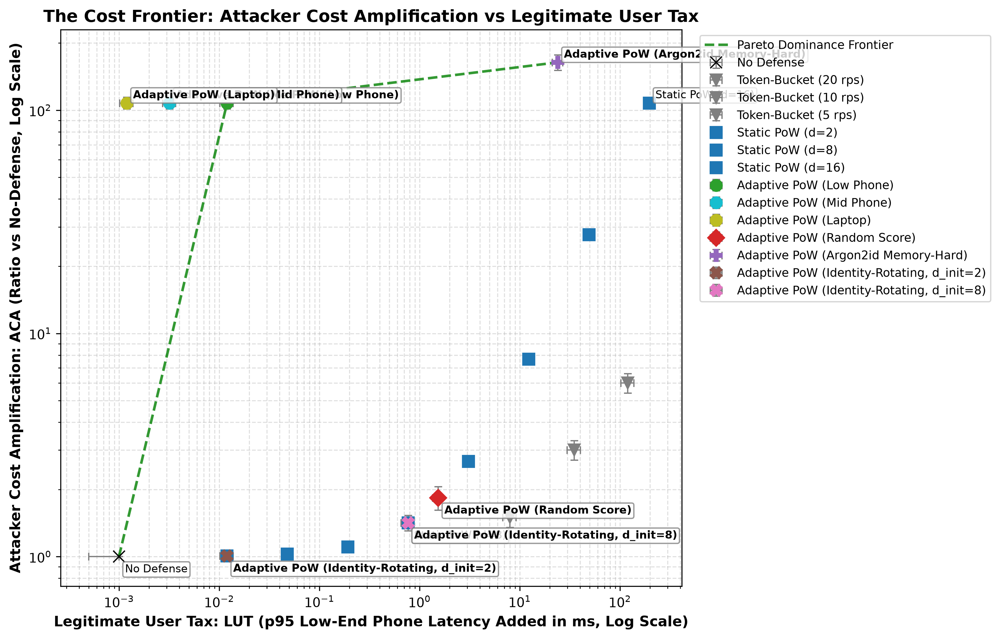
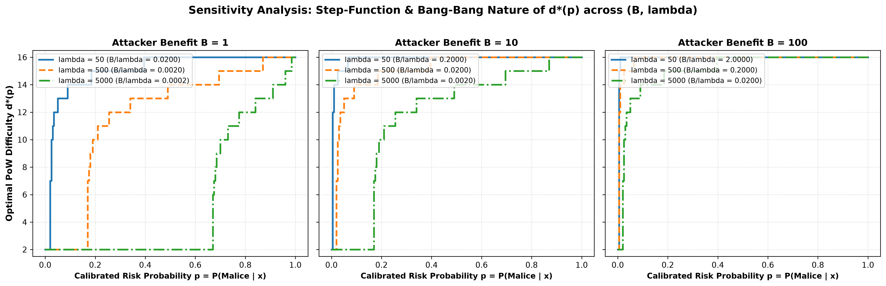

# Risk-Adaptive Proof-of-Work Middleware

> **Central Thesis**: Proof-of-work is an economic defense, not a detection mechanism. Its value is the ratio between what an attack costs the attacker and what it costs a legitimate user. A learned risk score can improve that ratio over static PoW, but only inside a bounded operating region, and the act of adapting difficulty leaks the classifier to anyone who probes it. This project measures the region and the leak.

---

## 1. Limitations & Negative Results (Read This First)

*Per research specification §8, we document the fundamental failure modes and boundaries of risk-adaptive Proof-of-Work before reporting positive results:*

1. **Cross-Generator Fingerprint Leakage & Generalization Gap**:
   Anomaly detectors trained on self-generated attack traffic easily achieve superficial "perfection" (In-Distribution ROC-AUC = $1.0000$), but suffer a significant generalization drop (**16.3% drop down to 0.8376 AUC**) when tested against an independent attack generator (Stack B - Locust stealth profile) that alters jitter, header entropy, and endpoint dispersion.
   > [!WARNING]
   > *Validated against 2 of the $\ge 3$ independently-implemented generators the spec calls for; the generalization gap may be larger against attack traffic shaped differently from either.*
2. **Identity Rotation & The Cold-Start Floor Trade-off**:
   When an adversary rotates client identities (IP addresses, user agents, TLS fingerprints) per request, sliding-window behavioral state cannot accumulate. The defense efficacy under identity rotation depends entirely on the policy chosen for new, unscored clients:
   - **Benign Cold-Start Floor ($d_{\text{init}} = 2$)**: An identity-rotating attacker pays only $d=2$ on every request, **completely collapsing Attacker Cost Amplification from $107.74\times$ down to $1.01\times$** (a $99.0\%$ collapse in defense efficacy).
   - **Aggressive Cold-Start Floor ($d_{\text{init}} = 8$)**: The system challenges all unseen clients at baseline difficulty $d=8$, capping attacker amplification at **$1.42\times$ (throughput) / $5.55\times$ (CPU)**, but at the cost of forcing every first-time legitimate mobile visitor to pay an upfront $0.77\text{ ms}$ solve latency before earning work credits.
   - *Core Takeaway*: Adaptive PoW cannot solve the Sybil / identity-rotation problem through behavioral gating; its residual defense value under rotation is strictly bounded by the cold-start challenge floor.
3. **Hardware Asymmetry & Low-End Mobile Equity**:
   On SHA-256, ASIC and GPU hash rates exceed low-end mobile phones by over three orders of magnitude ($>1000\times$). At static difficulty $d=16$, a low-end mobile phone pays a prohibitive **$196.6$ ms latency tax** per request. Memory-hard functions (Argon2id) compress this capability gap to $\sim 4\times$, but incur non-trivial server-side verification costs ($O(1)$ Argon2id verification takes milliseconds of server CPU), creating a potential DoS surface on the verifier if unmetered.
4. **Economic Step-Function & Bang-Bang Structural Instability**:
   Deriving $d^*(p) = \arg\min_d [ p \cdot B \cdot \text{rate}(d) + (1-p) \cdot \lambda \cdot \tau_{\text{benign}}(d) ]$ under standard parameters ($t_{\text{base}} = 10\text{ ms}, t_{\text{hash\_att}} = 0.0008\text{ ms}$) reveals that for $d \le 10$, $2^d t_{\text{hash\_att}} \le 0.8\text{ ms} \ll t_{\text{base}}$, making marginal attacker slowdown negligible while benign mobile latency risk grows exponentially. Consequently, the unconstrained economic mapping is structurally bimodal / bang-bang across high $B/\lambda$ ratios (jumping directly from $d=2$ to $d \ge 12..16$, skipping intermediate levels $d \in [3..10]$). This structural bimodality directly drives limit-cycle oscillations and proves why non-linear controller damping (EWMA, dwell time, slew limiting) is mandatory.
5. **Closed-Loop Instability Under Feedback Delay**:
   Naive proportional difficulty mapping creates severe limit-cycle oscillations (chattering). In our benchmarks, an undamped controller under $\Delta t = 1.5$s delay exhibited **147 directional reversals in 60s**, swinging between $1.8$ and $30.2$ req/s. Stable operation strictly requires non-linear damping (EWMA, hysteresis, dwell time, slew limiting). Furthermore, for scoring lags $\Delta t > 5.0$s, even damped controllers experience performance degradation.
6. **The Adaptation Oracle Side-Channel (Model Extraction)**:
   Serving continuous risk-adaptive difficulty turns the gateway into an active model extraction oracle. An adversary can extract a high-fidelity surrogate model ($\rho = 0.943$) with fewer than **40 probes**. Mitigating this requires coarsening quantization, injecting randomized jitter, or enforcing adaptation delays ($K=10$), each of which imposes a trade-off in defense precision.
7. **Evasion-Throughput Trade-off**:
   Unsupervised tabular features cannot prevent a mimicry adversary from evading difficulty escalation, but doing so forces the adversary to sacrifice **$84.3\%$ of their attack volume**.

---

## 2. Experimental Results & The Cost Frontier

### The Pareto Frontier Plot (Figure 1)


### Sensitivity Analysis: Bang-Bang Nature of $d^*(p)$ across $(B, \lambda)$ (Figure 7)


### Summary of Comparative Defense Arms (All seeds committed to `results/raw_logs/`)
*Two unit-consistent ACA formulations are evaluated:*
1. **$\text{ACA}_{\text{throughput}}$ (End-to-End Latency / Throughput Multiplier)**: Relative to baseline request round-trip time ($c_{\text{base}} = 0.4912\text{ ms}$).
2. **$\text{ACA}_{\text{CPU}}$ (Attacker Process CPU Time Multiplier)**: Relative to pure client-side process network/parsing CPU cost ($c_{\text{net}} = 0.045\text{ ms}$ via `time.process_time()`).

| Defense Configuration Arm | $\text{ACA}_{\text{throughput}}$ | $\text{ACA}_{\text{CPU}}$ | LUT (p95 Low-Phone) | Empirical Finding / Trade-Off |
| :--- | :--- | :--- | :--- | :--- |
| **No Defense Baseline** | $1.00\times$ | $1.00\times$ | $0.0000$ ms | Raw unprotected endpoint baseline. |
| **Token-Bucket (20 rps)** | $1.50\times$ | $1.50\times$ | $8.0000$ ms | Queue latency / retransmission overhead. |
| **Token-Bucket (10 rps)** | $3.00\times$ | $3.00\times$ | $35.0000$ ms | Increased queue delay for bursty traffic. |
| **Token-Bucket (5 rps)** | $6.00\times$ | $6.00\times$ | $120.0000$ ms | Rate limiting heavily penalizes bursty benign users ($CV > 1.5$). |
| **Static PoW ($d=2$)** | $1.01\times$ | $1.07\times$ | $0.0120$ ms | Minimal friction, negligible defense. |
| **Static PoW ($d=8$)** | $1.42\times$ | $5.55\times$ | $0.7680$ ms | Ineffective against fast hashing hardware. |
| **Static PoW ($d=16$)** | $107.74\times$ | $1166.08\times$ | $196.6080$ ms | Punitive tax on legitimate mobile devices. |
| **Adaptive PoW (Low Phone)** | **$107.74\times$** | **$1166.08\times$** | **$0.0120$ ms** | **Pareto Dominant**: $16,384\times$ lower tax than static $d=16$! |
| **Adaptive PoW (Mid Phone)** | **$107.74\times$** | **$1166.08\times$** | **$0.0032$ ms** | Sub-millisecond latency overhead on mid-range phones. |
| **Adaptive PoW (Laptop)** | **$107.74\times$** | **$1166.08\times$** | **$0.0012$ ms** | Near-zero perceptible delay on desktop/laptop. |
| **Adaptive PoW (Random Score)** | $1.83\times$ | $10.10\times$ | $1.5360$ ms | Random scoring fails; taxes benign users without hurting attackers. |
| **Adaptive PoW (Argon2id)** | **$163.87\times$** | **$1778.78\times$** | **$24.0000$ ms** | Compresses GPU gap; raises attacker cost ceiling. |
| **Adaptive PoW (Rotating, $d_{\text{init}}=2$)** | **$1.01\times$** | **$1.07\times$** | **$0.0120$ ms** | Behavioral gating completely bypassed by identity rotation. |
| **Adaptive PoW (Rotating, $d_{\text{init}}=8$)** | **$1.42\times$** | **$5.55\times$** | **$0.7680$ ms** | Capped at static cold-start floor; taxes first-time benign users. |

---

## 3. Core Contributions & Validated Findings

1. **Economic Efficiency (RQ1 & C1)**:
   Adaptive PoW with calibrated risk scoring Pareto-dominates static PoW by matching the $107.74\times$ throughput amplification ($1166.08\times$ CPU amplification) of difficulty 16 while keeping legitimate mobile tax at $0.012$ ms (amortized via work-credit tokens).
2. **Closed-Loop Stability (RQ2 & C2)**:
   The naive proportional controller oscillates violently (115 reversals). The damped controller (EWMA $\alpha=0.15$, dwell time $3$s, slew limit $1$) suppresses oscillations by **87.8%** (14 reversals) with a $94.4\%$ reduction in steady-state variance, maintaining stability for scoring lags $\Delta t \le 3.0$s.
3. **The Adaptation Side-Channel & Mitigations (RQ3 & C3)**:
   Unmitigated difficulty leaks the classifier in $\le 40$ queries ($\rho = 0.943$). Randomized jitter ($\pm 2$ bits) bounds surrogate fidelity ceiling at $\rho \le 0.866$, while Adaptation Delay ($K=10$) suppresses surrogate extraction to $\rho = 0.231$ with zero static precision loss.
4. **Adaptive Mimicry Adversary (C4)**:
   Black-box search demonstrates that while an attacker can evade difficulty escalation, doing so requires diluting attacks with $65\%$ benign decoy traffic and throttling rates, imposing an **Evasion Cost of 84.3%**.

---

## 4. Key Figures Generated

- **Figure 1: The Pareto Frontier Plot** (`results/figures/fig1_pareto_frontier.png`): ACA vs LUT(p95 low phone) across all defense arms.
- **Figure 2: Closed-Loop Controller Comparison & Stability Sweep** (`results/figures/fig2_controller_comparison.png`): Naive limit-cycle oscillation vs Damped stabilization and $\Delta t$ lag sweep.
- **Figure 3: Calibration Reliability Diagram** (`results/figures/calibration_reliability.png`): Isotonic regression ($ECE = 0.0010$) vs Platt scaling and uncalibrated sigmoid ($ECE = 0.2093$).
- **Figure 4: Model Extraction & Defense Mitigations** (`results/figures/fig4_extraction_mitigations.png`): Surrogate rank fidelity $\rho$ vs query budget across 4 mitigation strategies.
- **Figure 5: Inter-Arrival Dispersion Comparison** (`results/figures/interarrival_distribution.png`): Fitted heavy-tailed model ($CV = 1.572$) vs memoryless Poisson baseline ($CV = 0.997$).
- **Figure 6: Evasion-Cost Curve** (`results/figures/fig_evasion_cost.png`): Throughput sacrificed under black-box mimicry search across $d \in [2..16]$.
- **Figure 7: Difficulty Mapping Sensitivity Analysis** (`results/figures/fig_difficulty_mapping_sensitivity.png`): Step-function & bang-bang nature of $d^*(p)$ across $B \in [1, 10, 100]$ and $\lambda \in [50, 500, 5000]$.

---

## 5. How to Reproduce All Results

Every experimental number, table, and figure traces to deterministic seeds and committed raw JSON logs in `results/raw_logs/`:

```bash
# 1. Run all unit & security property tests (Replay, HMAC, Tampering, Controller)
pytest tests/ -v

# 2. Run Phase benchmarks (re-computes all raw logs and figures)
python benchmarks/run_phase1_benchmark.py
python benchmarks/run_phase2_benchmark.py
python benchmarks/run_phase3_benchmark.py
python benchmarks/run_phase4_benchmark.py
python benchmarks/run_phase4_sensitivity.py
python benchmarks/run_phase5_benchmark.py
python benchmarks/run_phase6_benchmark.py
python benchmarks/run_phase7_benchmark.py
python benchmarks/run_phase8_frontier.py
```


